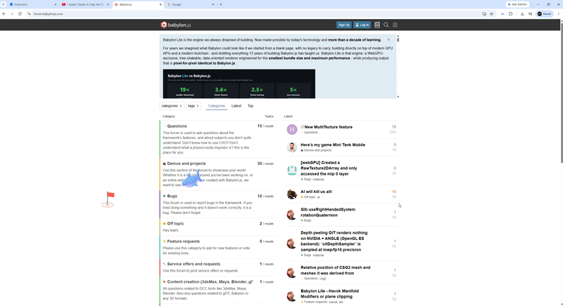
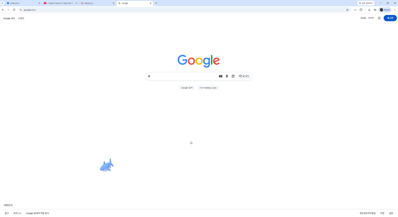
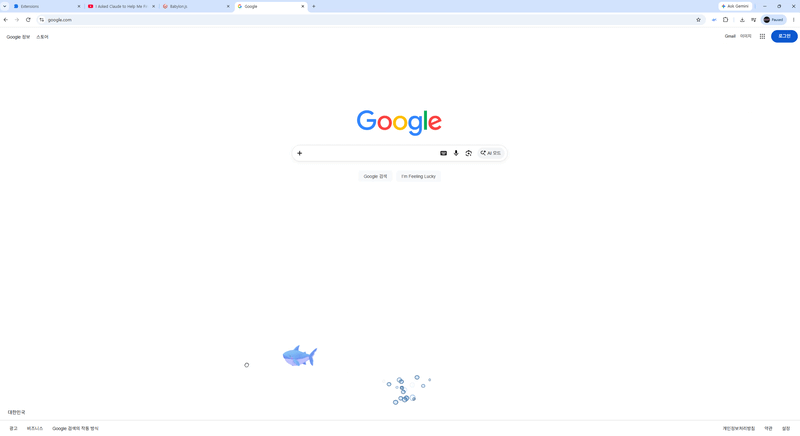

<!-- [🎞 Watch the video](https://www.youtube.com/watch?v=VIDEO_ID) -->

Most 3D on the web lives inside a box: a canvas on a page you built. I wanted the opposite — a character that lives **on top of every page you visit**, without that page knowing it exists, and without getting in the way of anything you do there.

**UNIT's CFC (Cute Floating Companion)** is a Chrome extension that renders an animated 3D shark over the active tab. It swims freely across the viewport, you can grab it and toss it into the edge of the screen, double-click empty space to call it over, and every so often it lunges at the camera to startle you. Clicks, scrolling and typing on the page underneath keep working exactly as before. This post walks through how that works: a **transparent overlay that never steals input**, a **screen-space camera** that makes the browser viewport the world, and the **tab lifecycle** that keeps a WebGL engine from living in every tab you have open.

Built with **Babylon.js 9** as a tree-shaken bundle, shipped as a **Manifest V3** extension.

> 📦 **Now available** on the [Chrome Web Store](https://chromewebstore.google.com/detail/units-cfc-%E2%80%94-cute-floating/fcodbljmmbhhkofinngcephgjjfpfcfl?hl=ko).

### 🎥 Swimming over any page



### 🎥 Double-click to call it over



### 🎥 Toss it into the wall



## Motivation

Desktop pets are an old idea, but they live in the OS, outside the browser — and the browser is where most of the day actually happens. A browser extension can reach every page, but the moment you inject UI into someone else's DOM you inherit their CSS, their z-index wars, their event handlers, and their performance budget.

The goal was a companion that behaves like part of the browser rather than part of the page: always on top, never in the way, cheap when you're not looking at it, and continuous across tabs as if it were a single creature moving through your browser.

## 1. Living On Top of Someone Else's Page

### 🔹 A closed Shadow DOM overlay

The content script injects a single custom element pinned over the viewport, with the canvas sealed inside a **closed** shadow root so no host stylesheet or framework can touch it:

```javascript
host = document.createElement("unit-cc-host");
host.style.cssText =
  "position:fixed!important;inset:0!important;width:100vw!important;height:100vh!important;" +
  "z-index:2147483647!important;pointer-events:none!important;contain:strict;";
const shadow = host.attachShadow({ mode: "closed" });
shadow.append(style, canvas); // style starts with `:host { all: initial; }`
```

A `MutationObserver` re-attaches the host if a single-page app wipes `<html>`'s children, which some frameworks do on navigation.

### 🔹 Transparency that actually composites correctly

The canvas has to be fully transparent except where the character is. The obvious setup is `alpha: true` with `premultipliedAlpha: false` — and it looks fine for the opaque shark. Then the first translucent mesh appears and everything goes muddy: pulse rings render grey, a red flag fades to salmon.

Babylon's blending writes **premultiplied** color into the framebuffer. Telling the browser compositor the canvas is _not_ premultiplied makes it multiply by alpha a second time. The fix is one flag:

```javascript
engine = new BABYLON.Engine(canvas, true, {
  alpha: true,
  premultipliedAlpha: true, // false double-darkens every translucent pixel over the page
  preserveDrawingBuffer: false,
});
scene.clearColor = new BABYLON.Color4(0, 0, 0, 0);
```

## 2. The Viewport Is the World — A Screen-Space Camera

A perspective camera makes "move the character to the mouse" a projection problem. Instead the scene uses an **orthographic camera where one world unit equals one CSS pixel**, X measured from the viewport center and Y from the bottom edge:

```javascript
camera.mode = BABYLON.Camera.ORTHOGRAPHIC_CAMERA;
function fitCamera() {
  camera.orthoLeft = -innerWidth / 2;
  camera.orthoRight = innerWidth / 2;
  camera.orthoBottom = 0;
  camera.orthoTop = innerHeight;
}
```

Now every behavior is plain 2D math in pixels: steering, edge bounces, double-click targets. Resizing the window just re-fits four numbers. Depth is still real, so the character turns and banks in 3D, and the "lunge at the camera" effect is a scale animation that reads as coming at the lens.

The model itself is normalized on load — scaled to a fixed on-screen height and centered on its bounding box — so any GLB can be dropped in without touching the behavior code.

## 3. Selective Click-Through

The overlay covers the entire viewport, so it must be invisible to input by default — `pointer-events: none`. But then how do you drag the character?

The trick is that **capture-phase listeners on `window` see every pointer event even when the overlay ignores them**. The content script hit-tests each move against an invisible, simplified proxy box parented to the character, and flips the overlay to `pointer-events: auto` only while the pointer is actually over it:

```javascript
function hitTest(x, y) {
  const pick = scene.pick(x, y, (m) => m === proxy, false, camera);
  return !!(pick && pick.hit);
}

window.addEventListener(
  "pointermove",
  (e) => {
    const hit = hitTest(e.clientX, e.clientY);
    if (hit !== STATE.hover) {
      STATE.hover = hit;
      setInteractive(hit, hit ? "grab" : "default"); // pointer-events: auto | none
    }
  },
  { capture: true },
);
```

Picking one box instead of a skinned mesh keeps this cheap enough to run on every move.

### 🔹 Drag jitter

The first drag implementation wrote the pointer position straight into the character and derived velocity from consecutive events. Pointer events arrive 1–2 ms apart, so that velocity was mostly noise — and because tilt and facing were driven by it, the character shook violently and kept flipping left/right.

The fix separates input from simulation. The event handler only updates a _target_; the render loop follows it with an exponential low-pass, velocity is low-passed per frame, and facing only flips past a dead-band:

```javascript
// pointermove: just record where the pointer wants the character
STATE.dragX = e.clientX - dragOffsetX;

// per frame
const kf = 1 - Math.exp(-DRAG_FOLLOW * dt);
const nx = STATE.x + (STATE.dragX - STATE.x) * kf;
STATE.vx += ((nx - STATE.x) / dt - STATE.vx) * (1 - Math.exp(-DRAG_VEL_SMOOTH * dt));
if (Math.abs(STATE.vx) > DRAG_FLIP_VX) STATE.facing = Math.sign(STATE.vx);
```

The smoothed velocity doubles as the throw velocity on release.

## 4. Only the Tab You're Looking At

A naïve extension declares a content script for `<all_urls>`, which means every open tab parses a 3.6 MB 3D engine and holds a WebGL context. With thirty tabs open, that's thirty GPU contexts for one character you can see in one place.

### 🔹 On-demand injection

The manifest declares **no content scripts at all**. The service worker injects the engine and the script only when a tab becomes the one you're looking at, after probing whether a live instance is already there:

```javascript
async function ensureInjected(tabId) {
  const [probe] = await chrome.scripting.executeScript({
    target: { tabId },
    func: () => typeof globalThis.__UNIT_CFC_ALIVE === "function" && globalThis.__UNIT_CFC_ALIVE(),
  });
  if (probe?.result === true) return;
  await chrome.scripting.executeScript({ target: { tabId }, files: ["vendor/babylon.bundle.js", "content_script.js"] });
}
chrome.tabs.onActivated.addListener(({ tabId }) => ensureInjected(tabId));
```

A per-tab in-flight map prevents double injection when `onActivated` and `onUpdated` fire together.

### 🔹 Mount while visible, dispose while hidden

Inside a tab, the whole 3D stack — host element, engine, scene, model — exists only while the tab is active. On `visibilitychange → hidden` the render loop stops immediately; after a short grace period the engine is disposed and the overlay removed, so GPU memory is actually returned. Flip back within that window and the same engine resumes, which keeps fast tab switching cheap. An async mount token guards the race where a tab is hidden while its model is still loading.

### 🔹 One creature, many tabs

To make it feel like a single character moving through the browser, the active tab acts as a **leader** that writes a normalized snapshot — position, velocity, yaw, behavior state, timers — to `chrome.storage.session` every 150 ms, under a short lease. When it's hidden, it writes one final snapshot with an expired lease, so the next tab mounts and picks up exactly where the last one left off, even mid-animation. Positions are stored as fractions of the viewport so the hand-over survives different window sizes.

## 5. The Orphaned Content Script

Reload an extension during development and any tab that was already open keeps running the _old_ content script — connected to an extension that no longer exists. Every `chrome.*` call from it then fails with `Extension context invalidated`.

The catch: that error is **thrown synchronously**, not as a rejected promise, so `.catch()` never sees it. Called from a render loop, it fires every frame.

```javascript
const extAlive = () => {
  try {
    return !!chrome.runtime?.id;
  } catch {
    return false;
  }
};

function safeStorage(fn) {
  if (!extAlive()) {
    goOrphan();
    return;
  } // dispose engine, remove overlay, go quiet
  try {
    const p = fn();
    p?.catch?.(() => {
      if (!extAlive()) goOrphan();
    });
    return p;
  } catch {
    if (!extAlive()) goOrphan();
  }
}
```

The orphan also reports itself dead through the same `__UNIT_CFC_ALIVE` probe, so the service worker injects the fresh version into that tab automatically.

## 6. What Counts as "Empty Space"?

Double-clicking empty space calls the character over and plants a flag. Double-clicking a link, a button, or a search field must do nothing. The browser has no API for "this click wasn't handled," so the decision is a stack of heuristics, each learned from a real failure:

- **Let the page go first.** The listener runs in the capture phase (so a page-level `stopPropagation` can't hide the event) but defers its decision with `setTimeout(0)`, so `defaultPrevented` reflects what the page's own handlers did.
- **Interactive ancestors.** `a[href]`, form controls, ARIA roles, `contenteditable`, and `[tabindex]` — but **not** `tabindex="-1"`, which Google and many React apps put on page-wide wrappers. Treating it as interactive silently disabled the feature on entire sites.
- **Cursor hints.** A computed `cursor: pointer` or `text` catches clickable `<div>`s with no semantic markup.
- **Chrome's auto-selection.** Double-clicking blank space often selects the _nearest word_ on that line. Rejecting any non-empty selection made the feature appear broken. Now the selection is rejected only if the click point lies inside the selection's client rects — otherwise it's a stray highlight, and it's cleared.

## 7. Making It Feel Alive

- **Swimming** is steering, not pathing: each leg picks a target that crosses at least a third of the viewport and often changes height, velocity steers toward it under an acceleration limit, the nose pitches with vertical speed and the body banks into turns. The GLB's swim clip plays throughout with its speed tied to movement.
- **The scare**: once a minute (configurable) the shark swims to the exact center, turns to face the camera, eases from 1× to 4.6× scale, holds with a slight tremble, turns to show its tail, and retreats to where it came from.
- **The goal flag** is fully procedural — a cylinder pole, an updatable ribbon whose vertices wave with amplitude growing away from the pole, and staggered tori tipped back into ground ellipses that expand and fade. The character stops _beside_ the pole rather than on it, so it doesn't cover the marker it just reached.
- **Wall bubbles** come from a fixed pool of 72 cloned planes sharing one canvas-drawn bubble texture, with per-bubble alpha via `mesh.visibility` — zero allocation at runtime. The emit direction always points back into the viewport: a right-wall hit sprays up-left, a left-wall hit up-right, and buoyancy plus a growing wobble turns them into rising, zig-zagging bubbles.

One small bug worth recording: computing velocity as `Δpos / dt` produced `NaN` whenever two frames shared a timestamp, and the smoothing filters then spread that `NaN` into every transform — the character simply vanished. A one-line guard skips zero-length frames.

## 8. Shipping to the Chrome Web Store

- **Bundle the engine.** MV3 forbids remote code, and the official UMD build of Babylon.js contains dynamic-import stubs. A tree-shaken **esbuild IIFE** of only the needed modules exposes a `BABYLON` global with no dynamic `import()`.
- **Don't name it after Chrome.** Google trademarks can't be used in an extension's name without permission ("for Google Chrome™" is fine in descriptions). The working title had "Chrome" in it; the shipped one doesn't.
- **Disclose local processing too.** The Web Store's user-data policy covers data handled locally, not just data that leaves the device. Pointer input and the clicked element's type are processed in real time and never stored or sent — and are disclosed anyway, with a privacy policy explaining exactly that.
- **Attribution.** The model is CC BY 4.0, so the listing, the popup and a bundled notices file carry title, author, source, license and a note that it was modified — alongside Babylon.js's Apache-2.0 license.

## Key Technical Challenges

- **Compositing over a live page.** `premultipliedAlpha: false` looks right until the first translucent pixel; Babylon's output must be composited as premultiplied.
- **Input without interference.** Capture-phase listeners plus a proxy hit-test let a full-viewport overlay stay click-through everywhere except the character.
- **One engine, not one per tab.** On-demand injection, mount/dispose on visibility, and a leased session snapshot make many tabs behave like one continuous character.
- **Errors that skip `.catch()`.** `Extension context invalidated` throws synchronously; every extension call is wrapped and orphaned instances tear themselves down.
- **"Empty" is a heuristic.** Deferred decisions, `tabindex="-1"` wrappers and Chrome's nearest-word selection each broke double-click detection until handled explicitly.

## Conclusion

The interesting part of putting 3D on top of the web isn't the rendering — it's **coexisting**. The overlay has to be invisible to the page's CSS, invisible to its input, invisible to its performance budget when you're not looking, and still feel like one living thing as you move between tabs.

The lesson I'd carry into any extension that draws over pages: **treat the page as someone else's house.** Seal your styles in a shadow root, take input only when it's unambiguously yours, release your resources the moment you're out of sight, and assume the page will do something you didn't expect.

---

**Stack:** Chrome Extension (Manifest V3) · Babylon.js 9 · esbuild · Vanilla JavaScript
