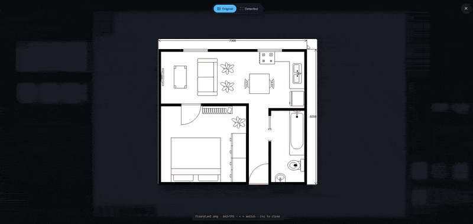
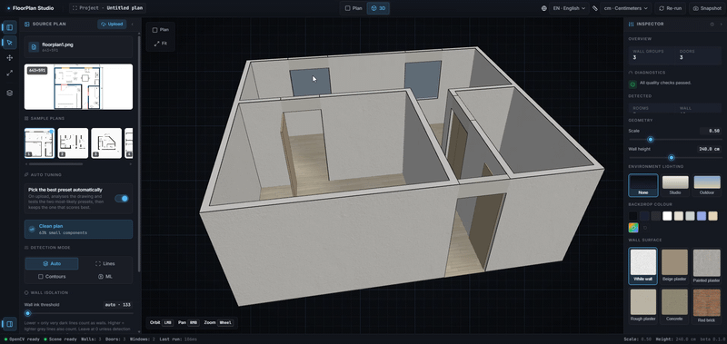
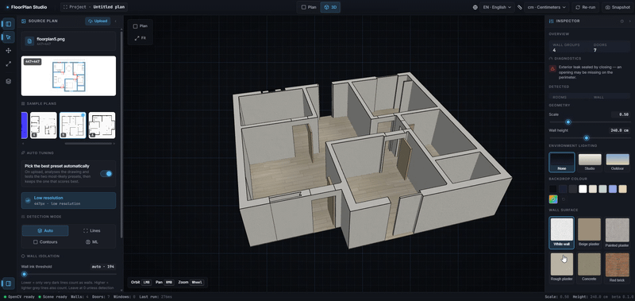

The pitch is simple: drop a 2D floor plan image into the browser, and walk around it in 3D. No server, no CAD import, no manual tracing. OpenCV.js does the vision, Babylon.js does the geometry, React does the UI — everything runs client-side.

The simple pitch hid every hard problem in computer vision. Floor plans look clean to a human and completely feral to an edge detector: text labels become wall fragments, dimension arrowheads become doors, sofa outlines become rooms. This post is about what it took to get a believable 3D extrusion out the other side.

[Check the live demo](https://unit-floorplan.netlify.app/)



## What's Actually in the App

- **Three detection modes:** `Lines` (Hough-based, default), `Contours` (legacy polygon-based), `ML` (ONNX semantic segmentation, bring-your-own model)
- OpenCV.js + ONNX Runtime **loaded from CDN at runtime** — no npm install, no WASM bundling
- Walls → `ExtrudePolygon`, floor → footprint polygon with convex-hull fallback
- **Doors and windows** detected separately and **cut as openings** in the walls (Lines + ML modes)
- **Ortho ↔ perspective** auto-toggle based on camera pitch, so a top-down plan view and a 3D walkthrough live on the same camera
- i18n (EN/KO) + configurable units (cm / m / inch); wall height is real-world centimetres with a default of 240 cm



## The Pipeline

```text
Image upload
  ↓
preprocess (grayscale → blur → adaptive threshold → invert)
  ↓
removeSmallComponents         ← kills text glyphs, arrowheads, small fragments
  ↓
maskFurnitureComponents       ← drops sofas/beds/toilets BEFORE Hough runs
  ↓
isolateWalls                  ← morphological open to keep only thick strokes
  ↓
skeletonize                   ← 1-pixel medial axis of each wall
  ↓
HoughLinesP                   ← raw line segments
  ↓
snapToManhattan + mergeCollinear + bridgeSegments
  ↓
detectDoors(HoughCircles) + detectWindows(perp-strip run counting)
  ↓
splitSegmentsAtOpenings       ← carve out door/window gaps
  ↓
per-segment extrude → Babylon ExtrudePolygon
  ↓
extractFootprintPolygon → buildFloorFromOuter
```

Every step above started life as a bug.

## Walls That Don't Have Gaps at the Corners

The first naive approach was: for each wall segment, extrude a rectangular prism. It looks right at 50% camera distance and falls apart up close — `HoughLinesP` endpoints routinely land a few pixels short of the actual corner, so adjacent prisms don't quite touch in 3D, and you get **visible seams at every L and T junction**.

I tried fixing it in 2D first: rasterize every segment at `thickness` px into a binary mask, morph-close small corner misalignments, run `findContours(RETR_CCOMP)` to get one polygon per connected wall network with room interiors as holes, extrude each polygon as a single mesh with Babylon-native holes. Beautiful in theory.

In practice: floor plans have doors. Walls don't fully enclose rooms. `RETR_CCOMP` doesn't return room interiors as holes when the "inside" isn't an enclosed region, so the extrusion ends up as a solid filled block that hides everything.

The approach I landed on is **per-segment extrusion with junction-aware endpoint snap**:

```ts
// Before extruding, snap each endpoint to its nearest neighbor
// if within junctionTol px. Then both endpoints become their midpoint.
const junctionTol = Math.max(wallThickness, 14);
```

Overlapping rectangles at corners fuse seamlessly in 3D. Door-opening endpoints have no nearby neighbor (they were just split out by `splitSegmentsAtOpenings`), so they don't get snapped and the opening stays visible. Simple, no magic triangulation needed.

## Rectangular Wall Ends

OpenCV's `cv.line(..., thickness > 1)` uses **circular end caps**. The caps don't matter in 2D preview, but when you rasterize a wall mask and extract its contour, those rounded ends become chamfered edges that produce **triangular or wedge-shaped wall tops** when extruded. Walls look like they're melting.

Fix: draw each segment with `cv.fillPoly` of a manually-computed rectangle (perpendicular offsets by `thickness / 2`). True butt caps, rectangular wall tops in 3D.



## The Furniture-Mask Pre-Step

In an early version, `HoughLinesP` happily traced the outlines of sofas, beds, and toilets as if they were walls. Downstream, `splitSegmentsAtOpenings` would see a short "wall" next to a real one and carve a spurious notch into the real wall. A bed in the middle of a bedroom literally removed a chunk from the exterior wall.

`maskFurnitureComponents` runs on the cleaned binary mask **before** `isolateWalls`, using `connectedComponentsWithStats`. For each component:

- **Keep** if it is the largest (building wall network)
- **Keep** if its bbox long side ≥ 160 px (long disconnected walls)
- **Keep** if its bbox area ≥ 15% of the biggest (secondary wall clusters)
- Otherwise: zero it out

Everything that looked like furniture gets killed before Hough ever sees it.

## The Floor Mesh Has Its Own Trap Door

Three ways to end up with an invisible or pitch-black floor that I lost real hours to:

**1. Self-intersecting outer polygon.** `RETR_EXTERNAL` on thin wall strokes produces self-intersecting contours around T-junctions. Earcut silently mis-triangulates them and only slivers render. Fix: `extractFootprintPolygon` morph-closes the wall mask, flood-fills, then extracts the external contour of the _filled_ interior — a simple polygon that can be concave but never self-intersects.

**2. `extractOuterPolygon` picks only the largest connected component.** Plans where interior gaps split walls into disjoint clusters came out half-sized. Keep a `wallsAABB()` fallback that computes the bounding box of the actual Babylon wall meshes.

**3. `sideOrientation: DOUBLESIDE` + `backFaceCulling = false` renders the floor black from above.** DOUBLESIDE already duplicates every triangle with opposite winding. Disabling culling then draws both copies at the same pixel; the `-Y`-normal copy wins the z-fight and receives no light from the top-down sun. Leave `backFaceCulling` at its default when using `DOUBLESIDE`.

## Tight approxPolyDP, or: Why Walls Looked Triangular

`approxPolyDP` with a percentage-based epsilon is a reasonable default for most polygons. For walls, it's a disaster. A whole wall network has a perimeter of 1500+ px, so `0.5% * perimeter` is 7–8 px — large enough to **collapse the two parallel edges of a thin interior wall into a single apex vertex**. Walls literally came out as triangles.

Fix: wall polygons use an **absolute** epsilon of `max(0.8, thickness/4)` px. The floor polygon still uses the percentage-based epsilon since it benefits from aggressive simplification.

## Doors Without the False Positives

Doors are detected with `HoughCircles` on the wall mask — door swing arcs are circular. The problem is **dimension-line arrowheads** are also circular, and they're everywhere on a drafted plan. Two tunables kill them:

- `doorMinRadius` bumped 15 → 25 (arrowheads are small)
- `doorSensitivity` tightened 50 → 35 (requires more arc evidence)

A second pass drops **fragment walls** shorter than `max(wallThickness * 2, minLineLength * 0.4)` — those are almost always chips left behind when a spurious door-opening chopped a real wall.

## ML Mode: Scaffolding, Not Magic

The classical pipeline works, but it's never going to be perfect — floor plans are a stylistic Rorschach, not a schema. ML mode exists as a bring-your-own-ONNX-model escape hatch:

```text
srcToTensor (ImageNet normalize)
  → session.run (ort.InferenceSession, WASM backend)
  → sigmoid [1,1,H,W] | argmax [1,C,H,W]
  → classBinaryMask per class (walls / doors / windows / floor)
  → walls: skeletonize → HoughLinesP → snap → merge  (reuses Lines mode)
  → doors/windows: findContours → centroid → project onto nearest wall
```

The post-processing is deliberately shared with Lines mode so the 3D output looks consistent regardless of where the segmentation came from. CubiCasa5k is the obvious candidate model but its dual-head output needs user-side wrapping to produce a single class map.

## Being Honest About the Rough Edges

Classical CV on floor plans is **never going to be 100%**. Rather than pretending every missed wall is a bug, the UI surfaces three real limits:

- **Hand-drawn or stylized plans** come through worse than drafted ones
- **Furniture-dense plans** survive the mask step but can still confuse Hough on borderline shapes
- **Non-standard wall thicknesses** need the `wallMinThickness` slider nudged

There's also a **detection preview panel** on the left that shows the wall mask, detected segments, doors, and windows as colored overlays on the source image — the single most useful UX decision in the whole app. Users can see immediately whether to tune parameters or just switch modes.

## What's Still Hard

- **Scale inference.** Without a dimension or scale marker in the image, "how tall should these walls be" is a guess. Default 240 cm (typical Korean apartment ceiling). I'd like to detect dimension strings via OCR and back-solve the scale, but that's its own project.
- **Multi-floor plans.** Everything assumes a single floor. Stairs, voids, and split levels are undetected.
- **Curved walls.** Hough is a line detector. Curved walls degrade into a jagged polyline. Fine for 95% of residential plans, visibly wrong for anything organic.
- **Drawing conventions.** Plans from different countries use different symbol sets for doors, windows, fixtures. The current defaults are tuned for Korean residential drafting.

## Takeaway

The 3D part was the easy part. Babylon handles extrusion, lighting, and cameras competently out of the box. The hard part was **everything upstream of the renderer** — teaching the pipeline to tell a wall from a sofa, a door from an arrowhead, a corner from a gap, and a self-intersecting contour from a well-behaved one.

If you're building vision-driven 3D anything in the browser, the mesh code is the last 10% of the work. The first 90% is defending against your own detector's confident mistakes.
