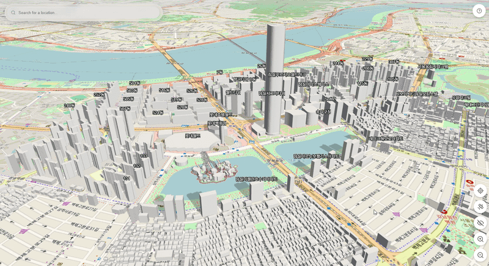
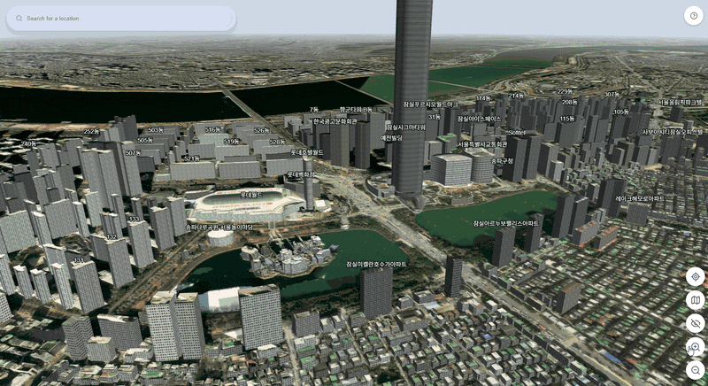
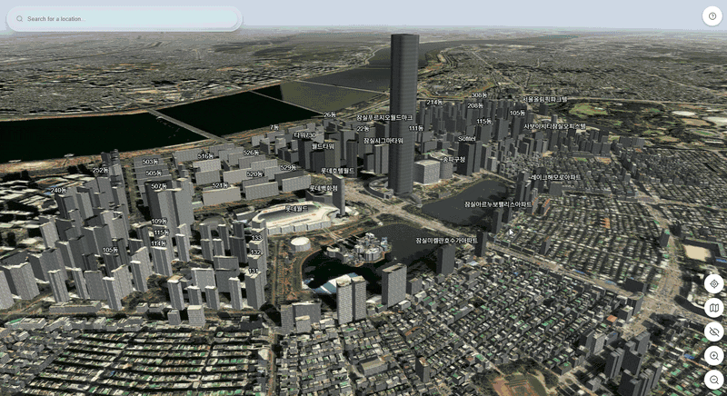

The [v1 post](https://unit-devblog.netlify.app/blog/post/2025-08-19-DigitalTwin-01) worked as a proof of concept, but running it on real Korean cities exposed every soft spot: main-thread stalls on big tiles, Overpass timeouts, drifting float precision after a long flyTo, and labels that shook on every camera tick.

v2 is a near-complete rebuild of the data layer with the renderer kept intentionally small. Here's what actually changed.

[Check the live demo](https://unit-digitaltwin.netlify.app)



## What Changed Since v1

- Tile fetch + JSON parse + earcut triangulation → **moved to a Web Worker**
- Every tile cached in **IndexedDB** with a 7-day TTL
- Primary data source swapped from Overpass to **OpenFreeMap vector tiles**, with Overpass as fallback
- Ground is now a **quadtree LOD pyramid** instead of a single TiledGround
- World origin **floats** — rebased on every `flyTo` to keep float32 precision
- **On-demand rendering** — frames only render when the camera signature changes

## The New Pipeline

```text
Main thread                        Web Worker
───────────                        ──────────
updateBuildings()
  → batch 3×3 tiles
  → postMessage("batch")  ───▶     handleBatch()
                                     1. cacheGet(IndexedDB)
                                     2. if miss → VectorSource.load()
                                                  └─ fallback → Overpass hedged fetch
                                     3. buildTileGeometry()  (earcut extrude)
                                     4. transferable ArrayBuffers
  ◀───  postMessage("tile")        cachePut(IndexedDB)
buildTileMeshes()
  → VertexData.applyToMesh()
```

The main thread now only touches GPU-bound work. The worker's job is pure CPU: fetch, parse, triangulate, hand back raw `Float32Array`/`Uint32Array` buffers that Babylon can wrap without copying.

## Two Data Sources, One Experience

**Vector tiles (OpenFreeMap, OpenMapTiles z14):** ~150–300ms per batch, globally cached on CDN, works offline after cache warms. Good enough for 90% of views.

**Overpass API fallback:** triggered when the vector source fails or is disabled. Uses a **hedged request** pattern — fire at the primary endpoint, then at the secondary after 5s if no response, take whichever wins. Endpoints that fail get a timed penalty so the next request skips them.

The trade-off is honest: vector tiles **drop small buildings** (planetiler generalizes to fit tile size budgets), so dense Korean residential districts come through sparse. Overpass returns everything — but it's also 100–300× slower and often capacity-limited. v2 picks the fast path by default and gives the option to flip (`buildingSource: "overpass"`) when completeness matters more than speed.

## Quadtree Ground + Floating Origin

The ground is now a **four-way LOD tree rooted at z10** (one tile ≈ 39km). The camera walks the tree, splitting a node when `distance < tileSize × lodFactor`. Each split spawns four z+1 children; parents stay visible until all four children are ready, so there are no empty holes mid-stream.


Over long distances, accumulating meters-from-greenwich coordinates wrecks float32 precision — building vertices start to shake. v2 **rebases the scene origin** on every `flyTo`:

```ts
flyTo(lon, lat) {
  this.cancelAllBatches();
  this.disposeAllGround();
  this.setOrigin(lon, lat);          // ← new origin at user's location
  this.camera.setTarget(Vector3.Zero());
  // ... next tick streams tiles around (0, 0, 0)
}
```



## Label Stability: A Subtle UX Lesson

v1 labels shook noticeably when the camera rotated. The cause wasn't projection math — it was the **slot reuse strategy**. The old code assigned the Nth passing candidate to `slot[N]`, which meant a single label being culled at the screen edge would cascade-shift every slot behind it.

v2 keeps a **persistent `Map<labelKey, slot>`**: the same building always lives in the same slot while it's on-screen. Only newly accepted labels take freed slots. Result — labels now track the 3D world smoothly, and only new entries ever "pop in."

## Being Honest with Users

OSM data is uneven, especially in Korea. Rather than pretending every missing building is a bug, v2 adds a small **data-info popover** (top-right `?` button) that lists the four realistic limits:

- Mapping coverage varies by district
- Recent construction may not be in OSM yet
- Public Overpass servers get overloaded
- Height/shape falls back to area-based estimation when tags are missing

There's also a **toggle to hide 3D buildings**, so users (and me, debugging) can verify the extruded footprints line up with the OSM raster outlines underneath.

## What's Still Hard

- **Public Overpass capacity.** When the main server is at capacity (502s, 30–60s batch times), the user feels it. Self-hosting is the only real fix.
- **Vector-tile generalization.** Smaller buildings missing from z14 vector tiles aren't recoverable without a different source (VWorld, MapTiler, or custom planetiler builds).
- **Cross-tile buildings.** Footprints with centroids near tile borders can get assigned to the wrong tile after MVT clipping. Centroid-based ownership works but isn't perfect.

## Takeaway

v1 proved the concept. v2 is about **making the data layer behave** — moving work off the main thread, caching aggressively, degrading gracefully, and being honest with users when the underlying data has gaps.

If you're building anything city-scale in the browser, the highest-leverage decisions aren't about the renderer. They're about **where the data comes from, how fast it arrives, and what you show when it doesn't**.
